# Campusmate – Campus Lost & Found

**Lost it? Found it? Campusmate it.** A Flutter app where students post lost
or found items with a photo. The app matches lost posts with found posts
automatically, so things get back to their owners faster. Only college
email addresses can join.

MAD (Mobile Application Development) lab mini project.

## Team

| Name |
|------|
| Jaipreet |
| H Dhruva |
| Manik |
| Naveen Kumat |

## Screenshots

All taken at phone size (390 × 844) in mock mode. Every screen is in [`docs/screenshots/`](docs/screenshots/).

| Login | Home feed | Category filter | Item detail |
|---|---|---|---|
| 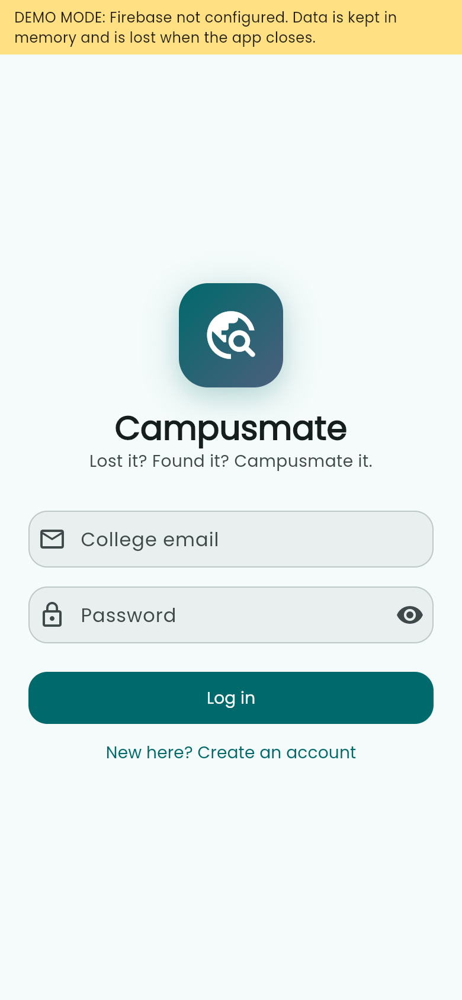 | 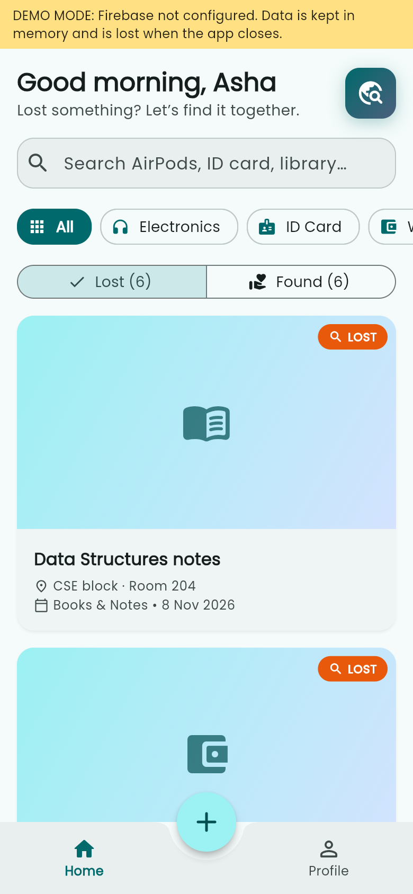 | 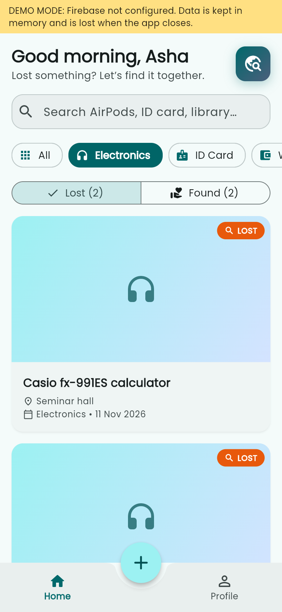 | 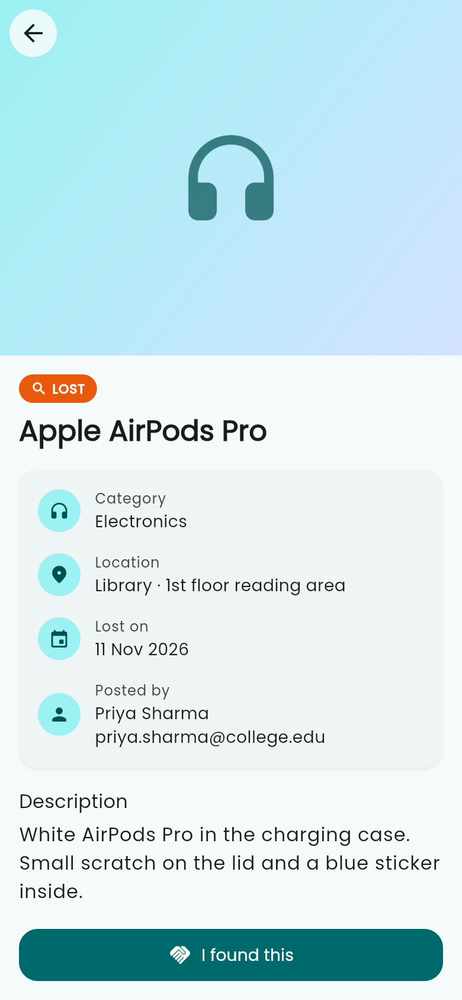 |

| Possible matches | Post: photo step | Post: validation | Posted with photo |
|---|---|---|---|
| 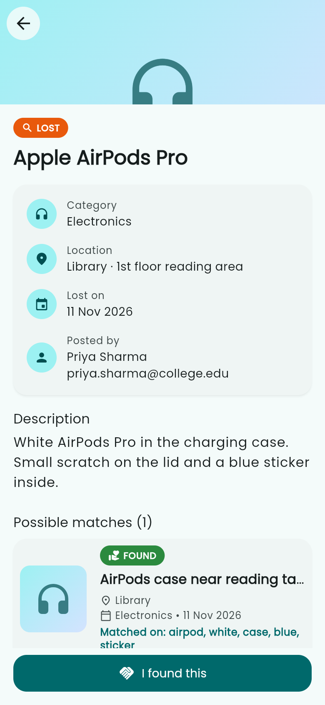 | 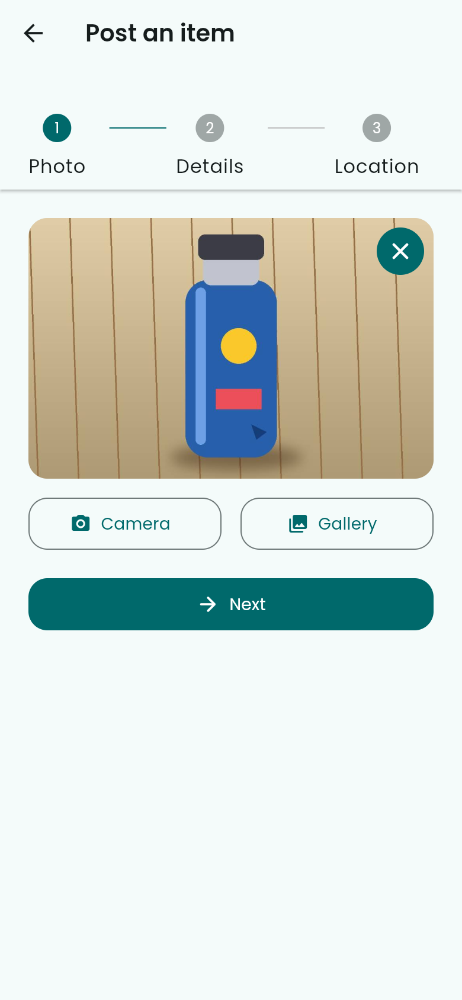 | 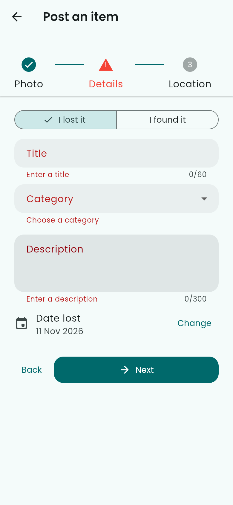 | 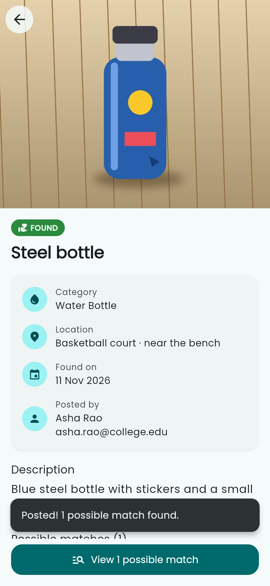 |

| Loading skeleton | Demo menu | Match alert | Dark mode |
|---|---|---|---|
| 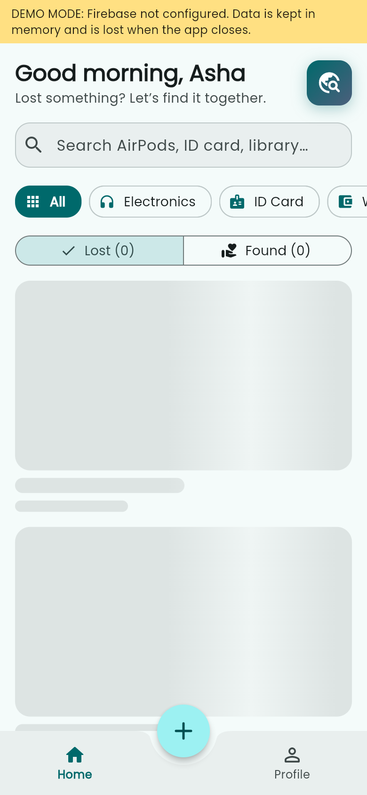 | 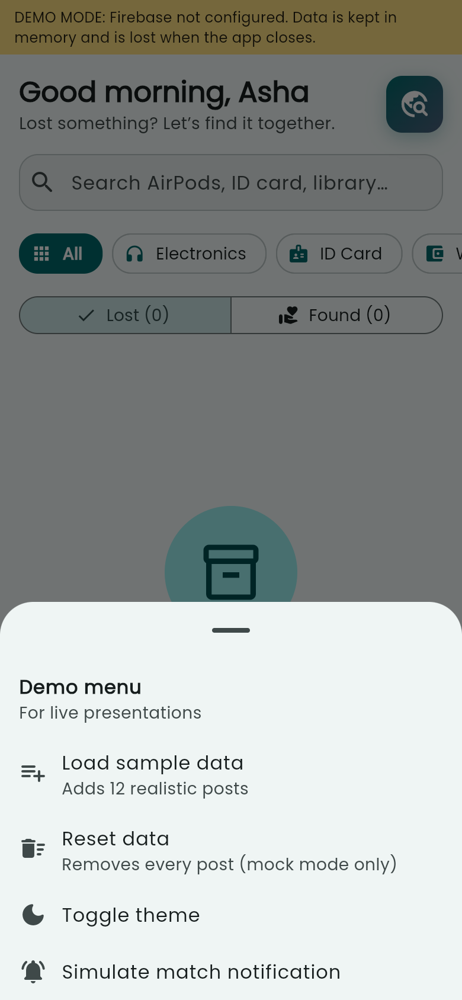 | 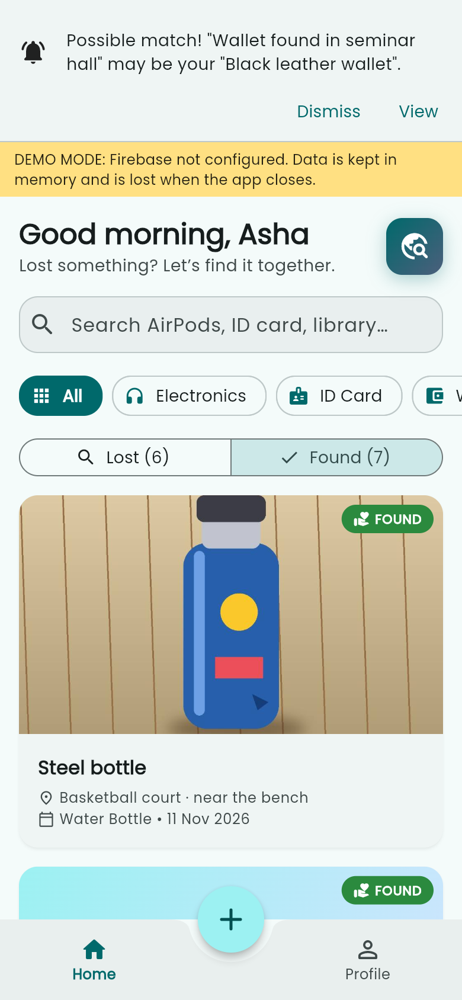 | 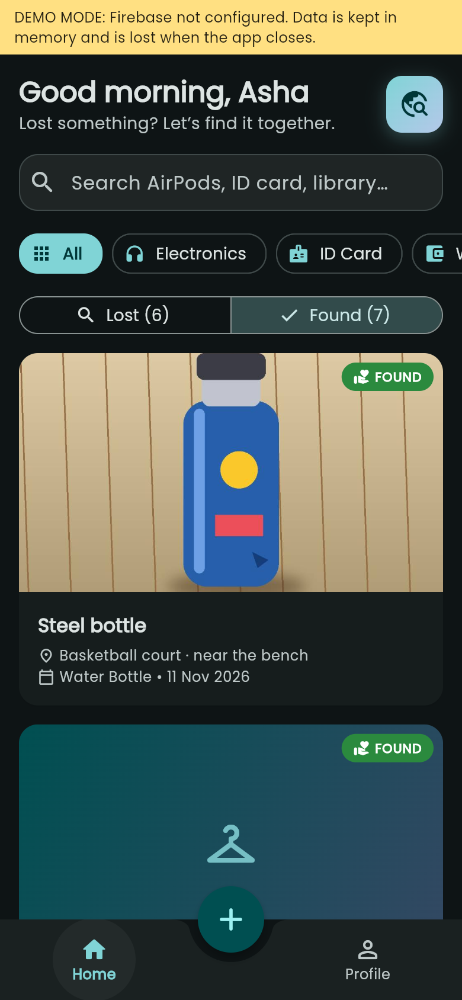 |

## Features

### Done (Review 1)

- Sign up / log in / log out, limited to the college email domain (`lib/config.dart`)
- Home: greeting, keyword search, category chips with icons, Lost / Found switch with counts,
  image-led cards, pull-to-refresh, shimmer skeleton while loading, friendly empty and error states
- Post an item in 3 steps (Photo → Details → Location): camera or gallery photo, compressed under
  300 KB and stored as base64 text, validation on every step, campus place picker
- Item detail: large Hero-animated image, LOST / FOUND / RETURNED badge, info rows with icons,
  description, sticky action button
- **Automatic matching:** lost ↔ found, same category, shared keywords, best match first,
  with the matched words shown
- Bottom navigation bar with a centred **+** button; Profile screen with a dark-mode switch
- Material 3 theme from one teal seed colour, Poppins font (bundled, works offline),
  16 px rounded cards, 8 px spacing grid, smooth page transitions
- **Mock mode** (no Firebase, no internet) with a hidden demo menu: long-press the logo →
  load 12 sample posts, reset data, toggle theme, simulate a match alert
- 21 automated tests, including one that walks through every screen on a 320 × 568 phone
  to catch layout overflow

### Coming next

- **Phase 2 (by 20 Nov):** claim flow with proof question, chat after approval, phone notifications,
  My Posts (edit / delete / mark returned), more validation and offline handling
- **Phase 3 (by 27 Nov):** app icon and splash, Firestore security rules, release APK,
  viva notes and presentation outline

## Tech stack

| Part | Used |
|------|------|
| UI | Flutter 3.47 (stable), Dart 3.13, Material 3, google_fonts (Poppins, bundled) |
| State | Provider (`ChangeNotifier`) |
| Login | Firebase Authentication (email + password) |
| Database | Cloud Firestore (realtime listener) |
| Photos | image_picker + image (compression), stored as base64 in Firestore |
| Not used | Firebase Storage and Cloud Functions (both need the paid plan) |

## Run it in mock mode (no setup)

```bash
flutter pub get
flutter run -d chrome    # in Chrome, then use DevTools device mode for phone size
flutter run              # on an Android phone (see below)
```

`lib/config.dart` has `USE_MOCK_DATA = true` by default. A yellow **DEMO MODE** strip shows that
accounts and posts live in memory only and disappear when the app closes.

**Demo tip:** after signing up, **long-press the teal logo** on Home to open the demo menu and
load the 12 sample posts. The 4-minute review flow is in [`docs/DEMO_SCRIPT.md`](docs/DEMO_SCRIPT.md).

## Run on an Android phone (USB)

Needs JDK 17 and the Android SDK command-line tools + platform-tools on the laptop
(not set up yet on the dev laptop, see `docs/DECISIONS.md` D30).

On the phone:

1. **Settings → About phone** → tap **Build number** 7 times until it says "You are now a developer".
   (Some phones: Settings → About phone → Software information → Build number.)
2. **Settings → System → Developer options** → turn on **USB debugging**.
3. Connect the phone to the laptop with a data USB cable. Choose **File transfer** if asked.
4. On the phone, tap **Allow** on "Allow USB debugging?" (tick "Always allow from this computer").

On the laptop:

```bash
adb devices          # the phone should be listed as "device" (not "unauthorized")
flutter devices      # the phone should appear here too
flutter run          # builds and installs the app on the phone
```

If `adb devices` shows nothing, try another cable or USB port, and install your phone maker's USB
driver (Windows only).

## Connect Firebase (one-time, team lead)

1. <https://console.firebase.google.com> → **Create a project** → name `campusmate` (Analytics not needed).
2. **Build → Authentication → Get started → Sign-in method → Email/Password → Enable → Save.**
3. **Build → Firestore Database → Create database** → location `asia-south1 (Mumbai)` →
   **production mode**. Open **Rules**, paste the rules below and click **Publish**.
   They allow only logged-in users. Phase 3 adds stricter rules.

   ```
   rules_version = '2';
   service cloud.firestore {
     match /databases/{database}/documents {
       match /{document=**} {
         allow read, write: if request.auth != null;
       }
     }
   }
   ```

4. Install the tools once (Node.js needed):

   ```bash
   npm install -g firebase-tools
   dart pub global activate flutterfire_cli
   firebase login
   ```

5. In this folder: `flutterfire configure --project=<your-project-id> --platforms=android`.
   This creates `android/app/google-services.json` (git-ignored: **never commit it**).
6. Set `USE_MOCK_DATA = false` in `lib/config.dart` and run on Android.

Teammates: get `google-services.json` from the team lead privately and put it in `android/app/`.

**College domain:** set `ALLOWED_EMAIL_DOMAIN` in `lib/config.dart`, for example `'dsce.edu.in'`.
Empty means any email is allowed (handy for testing).

## Checks

```bash
flutter analyze   # no issues
flutter test      # 21 tests
```

## Project structure

```
lib/
  main.dart            entry point: picks mock or Firebase services
  app.dart             MaterialApp, theme, routes, providers
  config.dart          USE_MOCK_DATA, email domain, categories, campus places
  theme.dart           Material 3 theme, spacing scale, badge colours
  routes.dart          named routes
  models/              Item, AppUser
  services/            Firebase + mock versions of auth and items, matching, images, sample data
  providers/           AuthProvider, ItemProvider, ThemeProvider
  screens/             login, signup, main shell (bottom bar), home, profile, add item, detail
  widgets/             ItemCard, CategoryChip, StatusBadge, EmptyState, PrimaryButton, ShimmerList, …
test/                  unit + widget tests
docs/                  DECISIONS.md, DEMO_SCRIPT.md, screenshots/
```

Why things are built the way they are: [`docs/DECISIONS.md`](docs/DECISIONS.md).

## License

Apache 2.0, see [LICENSE](LICENSE). The Poppins font is under the SIL Open Font License
(`assets/google_fonts/OFL.txt`).
