# Campusmate – Campus Lost & Found

**Lost it? Found it? Campusmate it.** An Android app (Java) where students post
lost or found items with a photo. The app matches lost posts with found posts
automatically. The real owner proves the item is theirs by answering a question
only they would know, and the two students then chat to hand it over.

MAD (Mobile Application Development) lab mini project.

## Team

| Name |
|------|
| Jaipreet |
| H Dhruva |
| Manik |
| Naveen Kumat |

## Screenshots

Drawn at phone size (390 × 844 dp) in demo mode. All 25 are in [`docs/screenshots/`](docs/screenshots/).

| Login | Home feed | Category filter | Item detail |
|---|---|---|---|
| 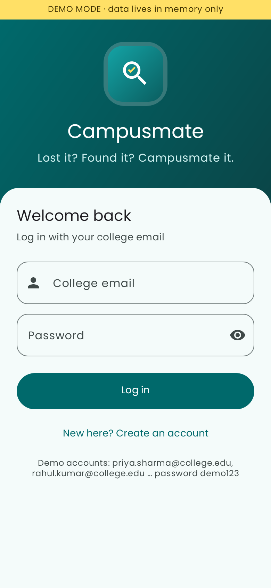 | 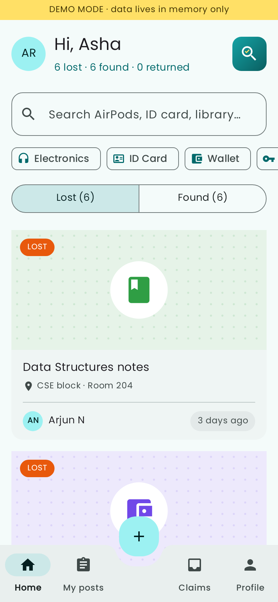 | 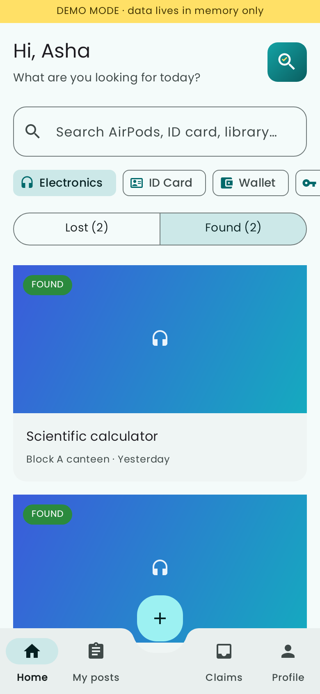 | 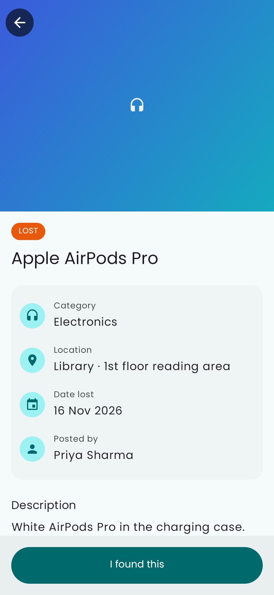 |

| Possible matches | Claim with proof question | Owner approves | Chat |
|---|---|---|---|
| 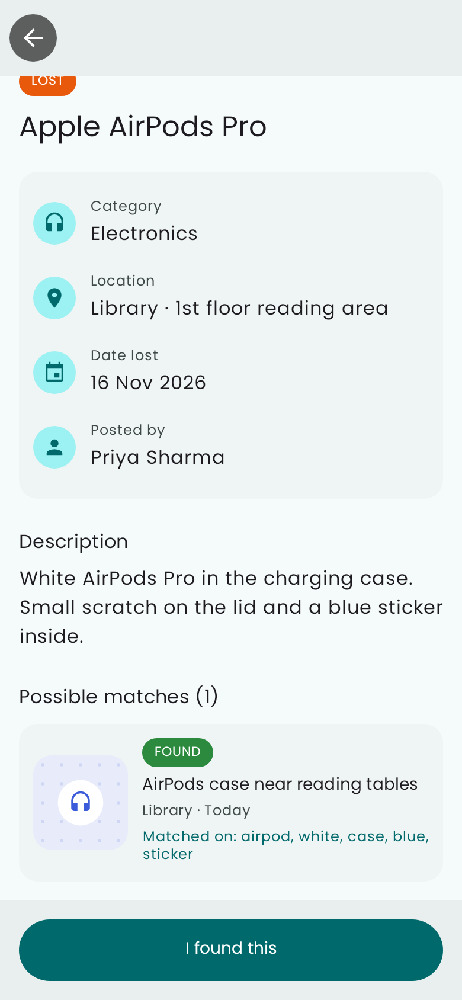 | 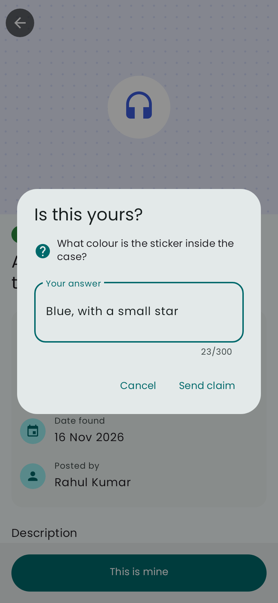 | 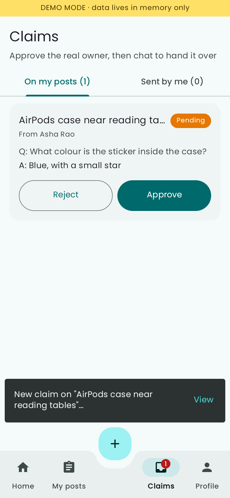 | 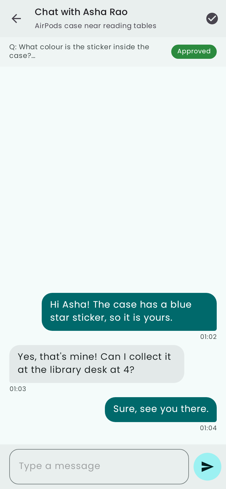 |

| Post: photo | Post: validation | My posts | Dark mode |
|---|---|---|---|
| 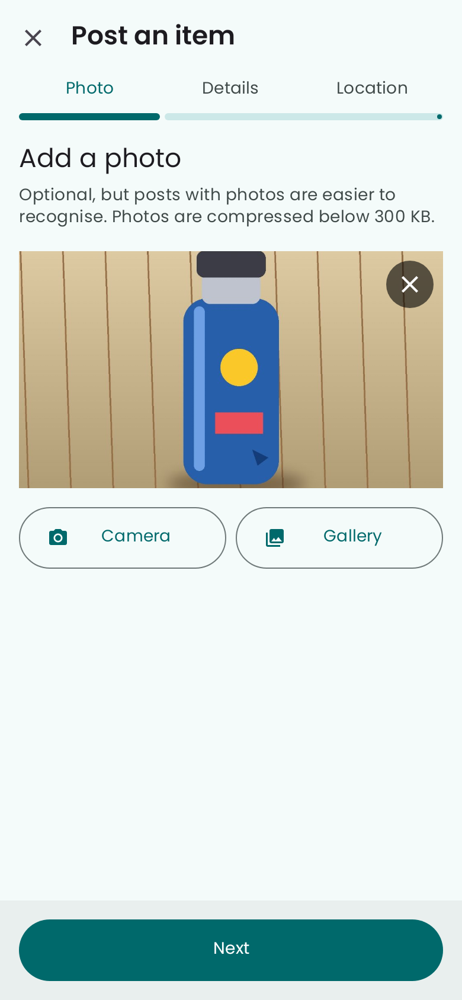 | 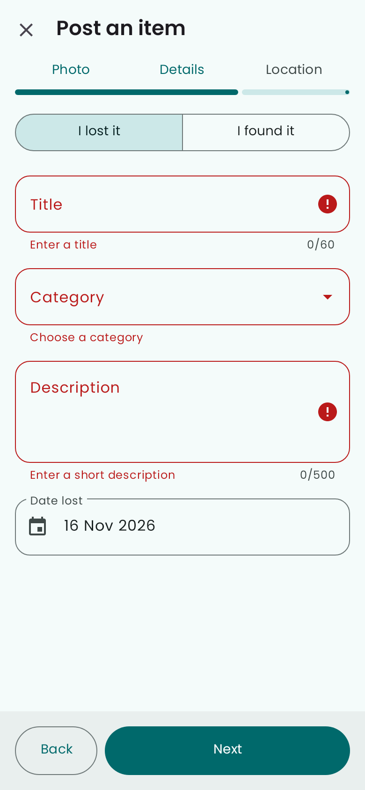 | 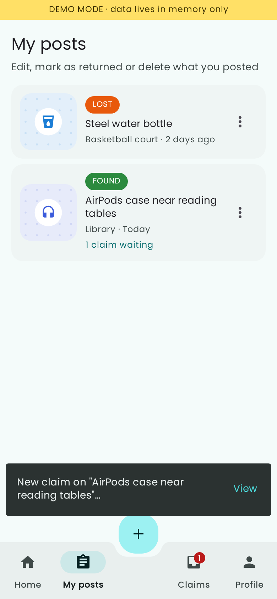 | 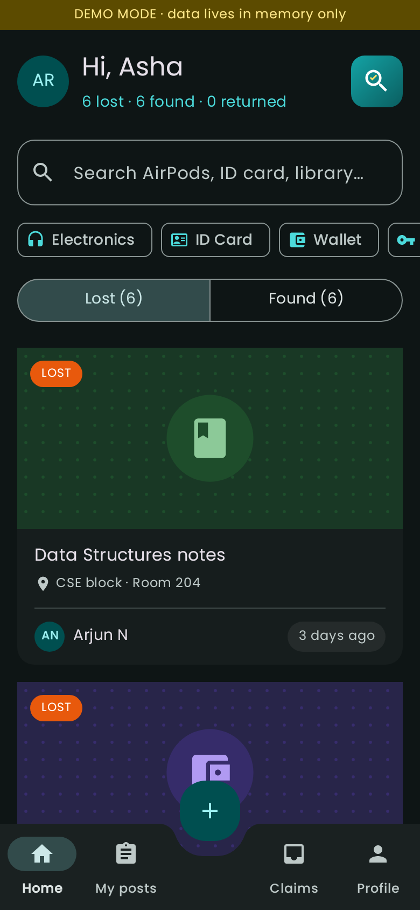 |

## Features

- **Accounts:** sign up, log in, log out with Firebase Authentication (email + password),
  optionally limited to the college email domain
- **Home feed:** greeting, search, category chips with icons, Lost / Found switch with counts,
  image-led cards, pull to refresh, skeleton cards while loading, friendly empty and error states
- **Post an item in 3 steps** (Photo → Details → Location): camera or gallery photo compressed
  below 300 KB, validation on every step, date picker, campus place picker
- **Item detail:** large image with a shared-element animation, LOST / FOUND / RETURNED badge,
  info rows, sticky action button
- **Automatic matching:** lost ↔ found, same category, shared keywords, best match first,
  with the matched words shown
- **Claims:** the finder sets a proof question; the claimant answers it; the finder approves or
  rejects. One claim per student per post
- **Chat** between the two students, opened only after approval
- **Notifications** for a new claim on your post, your claim approved / rejected, and a new
  post that matches yours (an in-app banner if notifications are turned off)
- **My Posts:** edit, mark as returned (or undo), delete with confirmation; shows waiting claims
- **Profile:** your stats, dark-mode switch (remembered), notification setting, log out
- **Works offline:** Firestore saves on the phone and syncs later; the app says so instead of
  spinning forever
- Material 3 theme from one teal colour, Poppins font, 16 dp rounded cards, 8 dp spacing,
  splash screen, adaptive app icon, light and dark
- **Demo mode** (no Firebase, no internet) with a hidden demo menu: long-press the logo on Home
- **Firestore security rules** ([`firestore.rules`](firestore.rules)) so a modified app still
  cannot edit other people's posts or read other people's claims
- **41 automated tests** that run on the laptop, including a 320 × 568 small-phone check

## Tech stack

| Part | Used |
|------|------|
| Language / UI | Java 17, XML layouts, Material Components 3, AndroidX, ViewBinding |
| Architecture | Activities + Fragments, ViewModel + LiveData, repository interfaces (mock and Firebase) |
| Lists | RecyclerView + ListAdapter (DiffUtil), SwipeRefreshLayout |
| Login | Firebase Authentication (email + password) |
| Database | Cloud Firestore (realtime listeners, offline cache) |
| Photos | Activity Result APIs (camera via FileProvider, photo picker), JPEG compression, base64 in Firestore |
| Notifications | NotificationCompat with a channel, POST_NOTIFICATIONS permission (Android 13+) |
| Settings | SharedPreferences |
| Tests | JUnit 4, Robolectric, Espresso |
| Build | Gradle 8.10.2, Android Gradle Plugin 8.7.3, compileSdk / targetSdk 35, minSdk 24 |
| Not used | Firebase Storage and Cloud Functions (both need the paid plan) |

## Install the APK on a phone (quickest)

The ready-built app is [`releases/campusmate-1.0.0.apk`](releases/) (about 9 MB, Android 7.0 or newer).

1. Copy the APK to the phone (USB, Drive, WhatsApp to yourself…) and tap it.
2. Allow **Install unknown apps** for the app you opened it from, when Android asks.
3. Open **Campusmate**. It starts in demo mode: log in with a demo account below, or sign up.

The APK is signed with the Android **debug key**, which is fine for team phones and the review.
For the Play Store you would need your own keystore (see "Release build" below).

## Demo mode (no setup)

`Config.USE_MOCK_DATA = true` in [`Config.java`](app/src/main/java/com/campusmate/Config.java) is the default.
A yellow **DEMO MODE** strip shows that data lives in memory only and is gone when the app closes.

Demo accounts (password **`demo123`** for all):
`priya.sharma@college.edu`, `rahul.kumar@college.edu`, `ananya.rao@college.edu`,
`kiran.m@college.edu`, `sneha.patil@college.edu`, `arjun.n@college.edu`.

**Long-press the teal logo** on Home for the demo menu: load 12 sample posts, reset data,
toggle the theme, simulate a match notification. The review flow is in
[`docs/DEMO_SCRIPT.md`](docs/DEMO_SCRIPT.md).

## Build it yourself

Needs **JDK 17** and the **Android SDK** (platform 35, build-tools 35.0.0). Android Studio works
too: *File → Open* this folder.

```bash
# Tell Gradle where the SDK is (once). Use forward slashes, e.g. on Windows:
echo "sdk.dir=C:/Android/sdk" > local.properties

./gradlew assembleDebug        # app/build/outputs/apk/debug/app-debug.apk
./gradlew testDebugUnitTest    # 41 tests on the laptop, no phone needed
./gradlew testDebugUnitTest -Pscreenshots   # also redraws docs/screenshots/
./gradlew assembleRelease      # app/build/outputs/apk/release/app-release.apk
```

## Run on a phone over USB

1. Phone: **Settings → About phone** → tap **Build number** 7 times.
2. **Settings → System → Developer options** → turn on **USB debugging**.
3. Connect with a data cable and tap **Allow** on "Allow USB debugging?".
4. Laptop:

   ```bash
   adb devices                 # the phone should show as "device"
   ./gradlew installDebug      # builds and installs
   ```

If `adb devices` shows nothing, try another cable or port, or install the phone maker's USB driver.

## Connect Firebase (one-time, team lead)

1. <https://console.firebase.google.com> → **Create a project** (`campusmate`, Analytics not needed).
2. **Build → Authentication → Get started → Sign-in method → Email/Password → Enable.**
3. **Build → Firestore Database → Create database** → `asia-south1 (Mumbai)` → **production mode**.
4. **Rules** tab → paste the whole of [`firestore.rules`](firestore.rules) → **Publish**.
   (Or with the Firebase CLI: `firebase deploy --only firestore:rules`.)
5. **Project settings → Add app → Android**, package name **`com.campusmate.campusmate`** →
   download **`google-services.json`** → put it in **`app/`**. It is git-ignored: **never commit it.**
6. In `Config.java` set `USE_MOCK_DATA = false`, then build and install again.

Teammates get `google-services.json` from the team lead privately.

**College domain:** set `ALLOWED_EMAIL_DOMAIN` in `Config.java`, e.g. `"dsce.edu.in"`.
Empty means any email is allowed (handy for testing).

## Release build

`./gradlew assembleRelease` signs with your own key when a git-ignored `keystore.properties`
exists in the project folder; otherwise it uses the debug key.

```bash
keytool -genkeypair -v -keystore campusmate.jks -alias campusmate -keyalg RSA -keysize 2048 -validity 10000
```

```properties
# keystore.properties  (never commit this file or the .jks)
storeFile=campusmate.jks
storePassword=...
keyAlias=campusmate
keyPassword=...
```

## Project structure

```
app/src/main/java/com/campusmate/
  CampusmateApp.java   starts theme, notification channel, repositories
  Config.java          USE_MOCK_DATA, email domain, categories, campus places
  model/               Item, Claim, ChatMessage, AppUser
  data/                repository interfaces, mock + Firebase versions, sample data, Session
  logic/               matching, validation, dates, images, notifications, theme setting
  ui/                  activities, fragments, adapters, demo menu
app/src/main/res/      layouts, drawables (vector icons), colours, themes, strings, fonts
app/src/test/          41 tests (JUnit, Robolectric, Espresso)
firestore.rules        server-side security rules
docs/                  DECISIONS, DEMO_SCRIPT, VIVA_NOTES, PRESENTATION, screenshots
releases/              ready-built APK
```

Why things are built the way they are: [`docs/DECISIONS.md`](docs/DECISIONS.md).
Viva preparation: [`docs/VIVA_NOTES.md`](docs/VIVA_NOTES.md).

## Status and known gaps

- Tested with 41 automated tests on the laptop (Robolectric draws the real screens).
  **Not yet tested on a real phone**, and **not yet run against a real Firebase project**
  (no project exists yet). The camera flow and real phone notifications need a phone check.
- Notifications only arrive while the app is open or still running in the background
  (no push server, see DECISIONS D45–D46).
- The first Flutter version is kept in git history: tag `flutter-phase1`.

## License

Apache 2.0, see [LICENSE](LICENSE). The Poppins font is under the SIL Open Font License
([`docs/licenses/Poppins-OFL.txt`](docs/licenses/Poppins-OFL.txt)).
