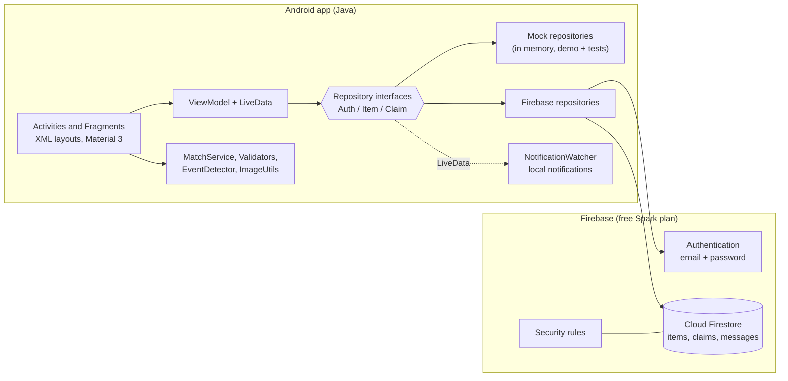

# Campusmate – presentation outline (8 slides)

Each slide: what goes **on the slide** (keep it short), and **say** (speaker notes).
Screenshots are in [`screenshots/`](screenshots/).

---

## Slide 1 – The problem

**On the slide**

- Things get lost on campus every day: ID cards, calculators, AirPods, bottles, wallets
- Today: WhatsApp group messages, notice boards, asking at the security desk
- Messages get buried, nobody knows if the item was returned, and anyone can say "that's mine"

**Say:** "Lost-and-found on our campus is scattered across chats and notice boards. Posts scroll
away in minutes, there is no way to search, and there is no check that the person collecting an
item is really the owner."

---

## Slide 2 – Our solution: Campusmate

**On the slide**

- One Android app for the whole campus, college email only
- Post a lost or found item with a photo in 3 steps
- The app **matches lost ↔ found automatically**
- Owner proves it is theirs with a **question only they can answer**, then the two students chat
- Tagline: *Lost it? Found it? Campusmate it.*
- Picture: `06_home_lost.png` + `10_detail_matches.png`

**Say:** "Campusmate puts every lost and found item in one searchable place, finds matches by
itself, and adds a simple proof step before anything is handed over."

---

## Slide 3 – Features

**On the slide** (two columns)

| Find | Return safely |
|------|---------------|
| Search, category chips, Lost / Found switch | Proof question set by the finder |
| Automatic matches with the shared words shown | Owner approves or rejects claims |
| Photo compressed below 300 KB | Chat opens only after approval |
| Notifications for claims, decisions, matches | Mark as returned, edit, delete (My posts) |

Plus: dark mode, works offline, splash and app icon, demo mode with sample data.
Picture: `11_claim_dialog.png`, `18_claims_pending.png`, `20_chat.png`

**Say:** "The left column is about finding your item; the right column is about giving it back
to the right person."

---

## Slide 4 – Architecture

**On the slide**

**Say:** "Screens never call Firebase directly. They talk to repository interfaces, which have two
versions: one in memory for the demo and tests, one for Firebase. One flag in `Config.java` picks
which. Matching and notifications run inside the app, so we need no paid server features: no
Cloud Functions, no Storage. The security rules protect the data on Google's side."

Firestore collections:
`items/{id}` (the posts) · `claims/{itemId_claimantId}` (one claim per student per post) ·
`claims/{id}/messages/{id}` (chat).

---

## Slide 5 – Tech stack

**On the slide**

| | |
|---|---|
| Language | Java 17 |
| UI | XML layouts, Material Components 3, AndroidX, ViewBinding |
| Architecture | Activities, Fragments, ViewModel, LiveData, RecyclerView + DiffUtil |
| Backend | Firebase Authentication, Cloud Firestore (realtime, offline cache) |
| Device features | Camera + photo picker (Activity Result APIs, FileProvider), notifications |
| Testing | JUnit, Robolectric, Espresso: 41 tests on the laptop |
| Build | Gradle, Android SDK 35, minSdk 24 (Android 7.0+) |

**Say:** "Everything here is standard Android from the MAD syllabus: Activities, Fragments,
Intents, RecyclerView, SharedPreferences, notifications, permissions, plus Firebase as the cloud
database."

---

## Slide 6 – Live demo

**On the slide:** just "Live demo" and the app icon.

**Do:** follow [`DEMO_SCRIPT.md`](DEMO_SCRIPT.md) (about 6 minutes): sign up → load samples →
see a match → claim with the proof answer → log in as the finder → approve → chat → mark returned →
post a found item → notification → dark mode.

**Backup:** if the phone or projector fails, show the screenshots in order (01 → 25).

---

## Slide 7 – Challenges and how we solved them

**On the slide**

| Challenge | What we did |
|-----------|-------------|
| Firebase Storage needs a paid plan | Compress photos below 300 KB and store them as text in Firestore |
| Anyone could claim an item | Proof question + owner approval; chat only after approval |
| Notifications without a server | Local notifications from data the app already receives |
| Demo must work without internet | Demo mode with in-memory data and sample students |
| No emulator on our laptops | Robolectric + Espresso tests, and a small-phone (320 × 568) test that catches cut-off views |
| Faculty required Java | Rewrote our first Flutter version as a native Java app |
| A modified app could cheat | Firestore security rules check every write on the server |

**Say:** pick two or three; the photo and proof-question ones are the most interesting.

---

## Slide 8 – Future scope

**On the slide**

- Push notifications when the app is closed (Firebase Cloud Messaging + a small server)
- Email verification so only real college students can join
- Map pin for the exact place on campus
- Image-based matching (compare photos, not just words)
- Admin view for the security desk to hand over items
- Paging for campuses with thousands of posts

**Say:** "Thank you. We're happy to take questions."

---

Team: Jaipreet · H Dhruva · Manik · Naveen Kumat
